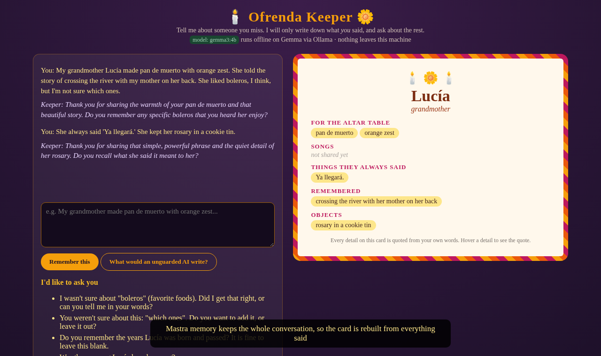

# 🕯️ Ofrenda Keeper 🌼

Tell it about someone you miss, and it builds a Día de los Muertos ofrenda card from **only the things you actually said**. Anything it is unsure about becomes a gentle question, not a made-up detail.

It runs entirely on your own machine: [Gemma 3 4B](https://ai.google.dev/gemma) (open weights) served by [Ollama](https://ollama.com), orchestrated by [Mastra](https://mastra.ai) (agent + memory + tools + workflow). There are no API keys, and your family's stories never leave your computer.



Demo video (about 2 min): [`docs/demo.mp4`](docs/demo.mp4). The sample memory in the demo is fictional.

## Why
If you ask an LLM to "make an ofrenda card for my grandmother", it will happily give her favorite songs, sayings and foods she never had. On our fictional test set, **49.7% of the claims an unguarded Gemma 3 4B made about the person were invented**. On a remembrance card, an invented memory is worse than an empty line.

## How it works
1. **Conversation with memory**: a Mastra `Agent` with `Memory` (LibSQL, local file) keeps everything you have said in one thread.
2. **Card workflow** (`createWorkflow`), rebuilt from your own messages each turn:
   - `extract`: Gemma lists each detail with a **verbatim quote** from your words.
   - `verify`: the `verify-quote` Mastra tool checks that the quote really is in your memories, that the detail does not go beyond it, and that you were not hedging ("I think", "maybe", "I can't remember").
   - The `ask-follow-up` tool turns every rejected or missing detail into a question.
3. **Altar card UI**: hover any detail to see the exact words it came from. The "What would an unguarded AI write?" button shows the same model with a plain prompt, for comparison.

Note: Gemma 3 through Ollama has no reliable native tool calling. The Mastra tools are therefore executed by workflow steps, not chosen by the model. The guard lives in code, not in a prompt the model can ignore.

## Results (12 fictional memories, hand-labeled)
| | Unguarded | Ofrenda Keeper |
|---|---|---|
| Invented claims about the person | 83 / 167 (49.7%) | 0 / 61 |
| Cards with ≥1 invented claim | 11 / 11 | 0 / 12 |
| Misattributed details | – | 2 / 61 |
| Key-detail recall | 87.5% | 91.7% |

Full method, labels and failure cases: [`eval/REPORT.md`](eval/REPORT.md).

## Run it
```bash
# 1. Ollama + model (about 3.3 GB RAM for 4B Q4). Or import a GGUF; see below.
ollama pull gemma3:4b
# 2. App
npm install
npm start            # http://localhost:4400
npm run eval         # re-run the fabrication eval
```
If `ollama pull` is unavailable, download `gemma-3-4b-it-Q4_K_M.gguf` from Hugging Face (unsloth/gemma-3-4b-it-GGUF) and use `ollama create gemma3:4b -f Modelfile` with `FROM ./gemma-3-4b-it-Q4_K_M.gguf`.

Environment variables: `OFRENDA_MODEL` (default `gemma3:4b`), `OLLAMA_URL`, `OFRENDA_DB`, `PORT`.

## Files
- `src/keeper.js`: Mastra agent, memory, tools, workflow, and the naive baseline
- `src/server.js`: Express API; `public/index.html`: altar card UI
- `eval/`: fictional test set, runner, results, hand labels, report
- `scripts/record_demo.py`: headless demo recording (Playwright + ffmpeg)

Built for the DEV Hacktoberfest Open-Source AI Challenge, Week 4: Ghost in the Machine. MIT licensed.
